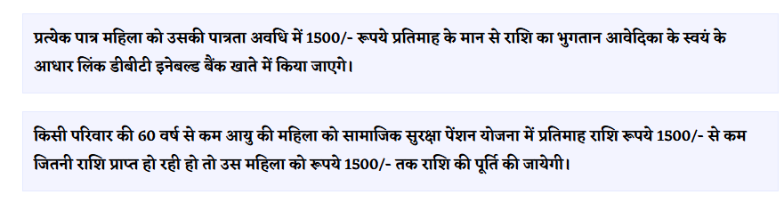

# Schemate: Project Notes

## Problem statement
Information about government schemes is scattered across many portals and PDFs, and is often written in formal English or complex Hindi. 
As a result, it is difficult for citizens to find out which schemes they are eligible for, what documents are required, and where to apply. 
This affects farmers, people with limited education, and SC/ST beneficiaries the most, since they depend on intermediaries or miss schemes entirely. 
Existing portals expect users to already know the scheme name and to search in English or formal Hindi, while many people ask questions in everyday Hindi or Hinglish.
## Objectives
1.Build a curated, verified dataset of central and Madhya Pradesh schemes.

2.Build a RAG-based assistant that answers Hindi, English and Hinglish queries with source citations.

3.Measure and compare retrieval strategies on a test set.

4.Add a voice interface for users who prefer speaking over typing

## Scope
- In scope: 40 verified schemes, MP + central, Hindi/English/Hinglish
- Out of scope: login, application tracking, 4000-scheme claim

## Related work

*Reviewed on 29 Oct 2026 from each repository's README.*

### A. Web portals (CRUD-style platforms)

Platforms such as [YojanaMitra](https://github.com/Symbiote07/YojanaMitra), [scheme-seva](https://github.com/9582anupam/scheme-seva), [scheme-finder](https://github.com/jaydipsinh13/scheme-finder) and [Centralised-Government-Schemes-Portal](https://github.com/rajs09/Centralised-Government-Schemes-Portal) are mainly database-driven web applications (React/MERN or PHP/MySQL) with filters, user profiles and, in some cases, a chatbot. They rely on manually maintained scheme databases and report no retrieval evaluation. Multi-language and voice support are either limited or listed only as future roadmap items.

### B. AI / RAG-based systems

| Repo | What it does | Tech stack | Data size | Evaluation | Hinglish / voice | Gaps |
|---|---|---|---|---|---|---|
| [Yojana-AI](https://github.com/pranaya-mathur/Yojana-AI) | Multi-agent RAG for scheme discovery and eligibility checking, with intent classification and self-correcting retrieval (Self-RAG, Corrective RAG) | FastAPI, LangChain, LangGraph, Qdrant, BGE-M3, Groq (Llama-3.3-70B), Ollama, Docker, Terraform, AWS ECS | 2,153 schemes, 10,812 chunks | LLM-as-judge for relevance and answer adequacy (~85% reported) | Mixed Hindi/English via BGE-M3; no voice | No voice interface; depends on Groq API limits; no labeled retrieval benchmark (hit rate / MRR) reported |
| [yojana-sahayak-assistant](https://github.com/Subh24ai/yojana-sahayak-assistant) | Offline multilingual voice agent (Gradio, CLI, MCP tool server) | Whisper large-v3-turbo, fine-tuned Qwen2.5-1.5B (QLoRA, MLX), FAISS, multilingual MiniLM, macOS TTS | 2,872 schemes (723 PDFs from myscheme.gov.in); 585 indexed facts | ASR WER 24%, perplexity, cross-script query benchmarks | Roman/Hinglish alias expansion, dual-script search, voice | Needs Apple Silicon; vector index covers only 585 facts; no language-wise retrieval comparison of strategies |
| [Niti Setu](https://github.com/abhay-patil-cse27/agri-scheme-eligibility-rag) | Agricultural RAG with voice assistant, document scanner and WhatsApp bot | React, Express, Groq, MiniLM, MongoDB Atlas Vector Search, Neo4j, ElevenLabs, Whisper, Twilio | 35+ PDFs, 10,000+ chunks | No benchmark tables reported | 10 regional languages; no Roman/Hinglish alias expansion | Agriculture only; depends on many paid third-party cloud APIs |
| [AI-Augmented Rule-Driven Multilingual Engine](https://github.com/Yuvasrimanbalaji/AI-AUGMENTED-AND-RULE-DRIVEN-MULTILINGUAL-ENGINE-FOR-GOVERNMENT-SCHEME-DISCOVERY-) | Rule-based matching plus Gemini chatbot | Flask, Gemini Flash, Pandas, Google Translate widget | Local CSV file | Rule-based relevance score; no accuracy study | 11 languages via Gemini/Translate | Static CSV dataset; no document-level retrieval; no measured accuracy |
| [Government-Scheme-Finder](https://github.com/jayashree0629-lab/Government-Scheme-Finder) | Live web search (SerpApi) plus Gemini to reason about eligibility | React, Express, SerpApi, Gemini SDK | Live search, no stored database | Evidence-grounding rules; no benchmark | Plain-English free text | Depends on live search latency; MVP limited to Tamil Nadu + Central |

### Gap and contribution (write this in your own words)

“Existing systems mostly demonstrate that scheme assistants can be built. My contribution is measuring how well different retrieval strategies work on Hindi, English and Hinglish queries, on a verified dataset, and how that changes with scale and voice input.”
## Learning log

day1: “Gemini ne ₹1,250 bataya, official source par ₹1,500. LLM ki jaankari purani thi.”

https://cmladlibahna.mp.gov.in/

(har din 2-3 lines: kya seekha, kya fail hua)
